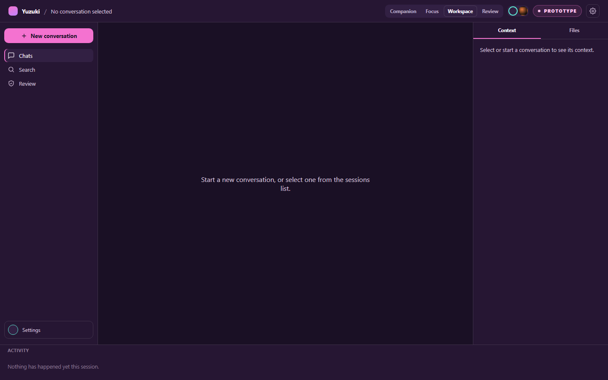
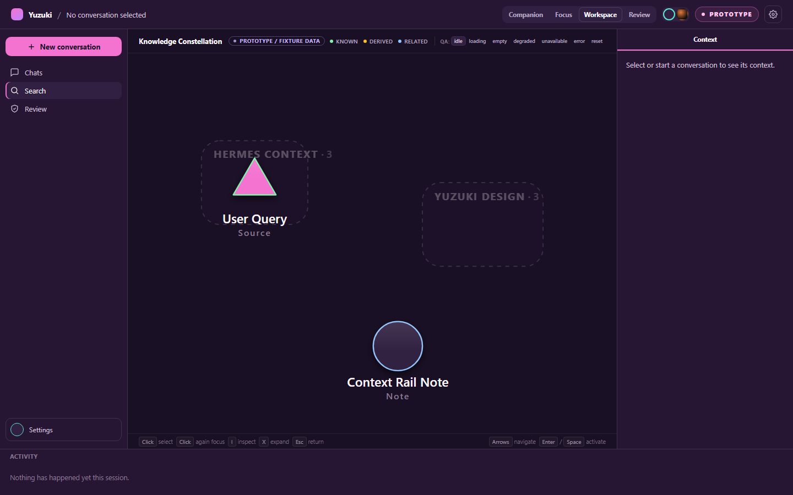

# Yuzuki

A Windows desktop AI companion that runs its conversations on a **local**
model, on your own machine, by default.

Yuzuki is a Tauri desktop shell around a local HTTP API and a local
[Hermes Agent](#hermes-attribution) runtime. In its default routing mode,
`PRIVATE`, a conversation never leaves `127.0.0.1`: no cloud provider is
contacted, and if the local runtime cannot serve the turn, Yuzuki **fails
the turn rather than substituting a cloud model**.

---

## Status

**Public distribution status: source only.** This repository currently
publishes source code only; no Yuzuki Windows installer or downloadable binary
is published from this snapshot.

**V1.1.** The local chat path is live-verified end to end; most other
capabilities are deliberately not implemented. This README states which is
which, because the repository's own product-truth module
([`server/lib/productTruth.mjs`](server/lib/productTruth.mjs)) does — and
the two are kept in agreement on purpose.

### What actually works

| Capability | State |
| --- | --- |
| Local Hermes chat | **Live-verified.** A dedicated, profile-scoped, loopback Hermes backend, spoken to over an authenticated WebSocket (TUI-Gateway JSON-RPC), answering from the local model the profile resolves. Streaming, cancellation, and honest failure states included. |
| Session persistence | Durable local SQLite. Survives a restart. No cloud sync. |
| Local session search | Bounded, deterministic full-text search over the active profile's Hermes SessionDB. Calls no model; results are never auto-admitted into prompt context. |
| Review / Approvals UI | A real session-scoped decision state machine — and nothing behind it. See the limitation below. |

### What does not exist

No persistent memory or memory writes. No Gmail, Calendar, Maps, or
reminders integration. No web or semantic search. No voice assistant. No
native iOS app. No autonomous actions and no message sending. No
end-to-end-encryption guarantee.

Cloud model routing is *implemented but not live-verified*: the code and
its deterministic tests exist, it is disabled by default, and this
repository has never made a live provider request through it.

---

## Routing modes

Yuzuki exposes seven routing modes
([`src/desktop/routingUi.mjs`](src/desktop/routingUi.mjs)):

| Mode | Meaning |
| --- | --- |
| `PRIVATE` | **Local only. No cloud fallback.** The default and the verified path. |
| `SAVER` | Cost-aware approved route. |
| `FAST` | Low-latency approved route. |
| `SMART` | Balanced approved route. |
| `DEEP` | Reasoning-oriented route. |
| `CREATIVE` | Creative-task route. |
| `ADVANCED` | Choose one approved model manually. |

### `PRIVATE` is fail-closed

This is the load-bearing guarantee, so it is worth stating precisely.

Before Yuzuki will start a Hermes backend at all, it validates the target
profile: the profile must exist, its config must be readable, it must name
a model, and its provider's `base_url` must be positively confirmed to be
loopback (`127.0.0.1`, `localhost`, or `::1`). LAN addresses are **not**
treated as local-safe. If any of those cannot be established, the runtime
does not start.

On that failure Yuzuki does not pick a different profile, does not enable a
provider, and does not fall back to a cloud model. It reports that the
local runtime is unavailable and stops. Ambiguity resolves toward refusing
to run, never toward reaching the network.

`ADVANCED` carries the complementary rule: the model list it offers is a
read-only projection of what the Hermes runtime has already approved.
Yuzuki does not invent, discover, or activate models — the routing
authority stays with Hermes.

---

## Architecture

```
┌──────────────────────────────────────────────┐
│ Tauri shell (Rust)            src-tauri/     │
│  · owns the window and the child API process │
│  · Windows Job Object ⇒ no orphaned children │
└───────────────────┬──────────────────────────┘
                    │ spawns
┌───────────────────▼──────────────────────────┐
│ Local API (Node)   server/  127.0.0.1:8787   │
│  · /api/hermes/*  status, sessions, search   │
│  · owns no model; brokers to Hermes          │
└───────────────────┬──────────────────────────┘
                    │ loopback WebSocket, JSON-RPC
┌───────────────────▼──────────────────────────┐
│ Hermes Agent runtime (Python, your machine)  │
│  · started --isolated --host 127.0.0.1       │
│  · owns sessions, memory, and routing        │
└───────────────────┬──────────────────────────┘
                    │ loopback HTTP
┌───────────────────▼──────────────────────────┐
│ Local model provider (e.g. Ollama)           │
└──────────────────────────────────────────────┘
```

The React frontend ([`src/`](src)) is served by the Tauri shell and talks
only to `http://127.0.0.1:8787`.

Two details are deliberate rather than incidental:

- **The Hermes runtime is not bundled.** You install it yourself. Yuzuki
  locates it at `%LOCALAPPDATA%\hermes\hermes-agent`, overridable with
  `HERMES_AGENT_ROOT`, and runs that install's own virtualenv interpreter
  so the runtime is exactly the one that was reviewed.
- **The shell owns the process tree.** The Hermes launcher re-execs a
  pinned interpreter and then exits, which defeats parent-walking process
  kills. The Tauri shell therefore assigns the API child to a Windows Job
  Object with `KILL_ON_JOB_CLOSE`, so closing the window reliably takes the
  whole descendant tree with it.

---

## Installing

For end users: **[docs/public/INSTALL.md](docs/public/INSTALL.md)** —
Windows prerequisites, installing the Hermes Agent runtime, creating the
`yuzuki-local` profile, pointing it at a local model, and confirming a
`PRIVATE` conversation works.

## Developing

For contributors: **[docs/public/DEVELOPMENT.md](docs/public/DEVELOPMENT.md)**
— repository layout, the dev loop, every npm script, and how to run the
test suite.

## Privacy and security

**[docs/public/PRIVACY_AND_SECURITY.md](docs/public/PRIVACY_AND_SECURITY.md)**
— what is stored, where, what leaves the machine, what the fail-closed
guarantee does and does not cover, and how to report a vulnerability.

---

## Screenshots

Captured from a synthetic public fixture, never from real conversation
state — see
[the capture manifest](docs/showcase/screenshots/yuzuki-v11-public/README.md)
for provenance.

### Desktop workspace



### Knowledge Constellation



---

## Limitations

Read these before forming an opinion about what Yuzuki is.

1. **The Approvals UI has no executor.** The review state machine
   (`REVIEW_REQUIRED → APPROVAL_REQUIRED → APPROVED/REJECTED/…`) is real,
   but approving a write or external action always renders
   `EXECUTION_UNAVAILABLE`. No execution engine exists anywhere in this
   repository. This is a designed interface, not a working automation.
2. **The Knowledge Constellation is a prototype.** It renders from a
   repository-owned fixture and is labelled `PROTOTYPE / FIXTURE DATA`
   in the app itself.
3. **Tools, memory, and skill learning are off.** The local chat path
   grants no tool use, no approval bridge, no memory writes, and no skill
   changes.
4. **Windows is the supported platform.** The process-lifecycle guarantee
   and the runtime path resolution are Windows-specific. Other platforms
   are neither tested nor claimed.
5. **Sessions are not encrypted at rest.** They are a local SQLite file
   with ordinary filesystem permissions.
6. **Cloud routing is unproven.** It is implemented, tested against a fake
   transport, disabled by default, and has never made a live request here.

---

## Public source provenance

This repository has one independent public root history. The private
engineering history it was exported from was not imported. The exact source
and accepted-binary relationship is recorded in
[`PUBLIC_PROVENANCE.md`](PUBLIC_PROVENANCE.md); existing Windows binaries were
not built from this public snapshot.

---

## License

MIT — see [LICENSE](LICENSE).

## Hermes attribution

Yuzuki is an independent desktop application that interoperates with a
separately installed copy of the open-source
[Hermes Agent](https://github.com/NousResearch/hermes-agent) project by Nous
Research. Hermes is not bundled with Yuzuki. Yuzuki is not affiliated with or
endorsed by Nous Research; each project is distributed under its own license.
